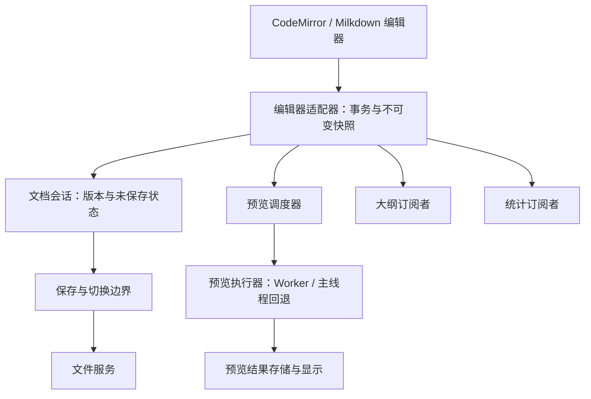

# 长文档输入性能优化方案

状态：核心优化已实施，实测结果及尚未验证的指标见 [实现与验证报告](editor-input-performance-results.md)。已按最新要求修订：预览实时跟随输入，不以增加等待时间换取输入流畅。

目标：让每次输入只承担编辑器本身的增量更新和轻量通知，将全文转换、预览、大纲、统计移出同步输入路径；保持中文输入、撤销重做、保存和文档切换的正确性。

## 1. 已确认的代码行为

| 位置 | 当前行为 | 优化方向 |
| --- | --- | --- |
| `app/src/components/Editor/CodeEditor.tsx` | 即使上层只消费 `onDocumentChange`，仍向 React CodeMirror 传入 `onChange`；底层在文档变化时调用 `doc.toString()` | 源码编辑采用文档事务通知，全文字符串按需生成 |
| `app/src/hooks/useEditorDocumentSync.ts` | 已有 150 ms 正文同步防抖和版本缓存，但仍与 EditorView、React setter、标签状态和预览调度直接耦合 | 保留已有正确性保护，逐步提取快照和调度边界 |
| `app/src/components/WorkspaceShell.tsx` | 预览通过 requestAnimationFrame 跟随输入；另有正文 effect 更新预览 | 收敛为一个预览调度入口；rAF 只用于提交显示结果 |
| `app/src/components/MarkdownViewer.tsx` | Worker 生命周期 effect 依赖 `value`，清理函数会 terminate；正文变化会重建 Worker | 分离 Worker 生命周期与任务发送，复用长寿命 Worker |
| `app/src/workers/markdownPreview.worker.ts` | Worker 执行预处理与分块；ReactMarkdown 解析、React 提交及 DOM 布局仍在主线程 | 先测量各段耗时，再决定是否迁移完整解析 |
| `app/src/modules/markdown/previewPipeline.ts` | 已有缓存和分块；包含 TOC 时回退全文路径 | 复用现有能力；后续处理目录和跨块依赖 |
| `app/src/components/Wysiwyg/blockCache.ts` | 块数量变化、旧快照不匹配等情况会全量重建；最终仍拼接全文 | 缓存与其实际基准版本比较，支持插入删除，并延迟拼接 |
| `app/src/components/Wysiwyg/WysiwygPane.tsx` | 内容变化调度全文大纲扫描；没有 requestIdleCallback 时退化成 1 ms 定时器 | 大纲按需刷新；明确回退调度预算，避免近似逐键执行 |
| `app/src/components/Editor/searchHighlight.ts` | 有搜索词时，文档或选区变化都会遍历全文匹配并重建装饰 | 分离匹配索引和当前选中项高亮 |

这些行为能说明存在额外工作，但不能仅凭静态检查判断哪一项占用最多。现有延迟同步、Worker、分块缓存和增量序列化应作为迁移基础。

## 2. 职责与数据流



职责边界：

- **编辑器适配器**：处理编辑器事件、输入法组合状态、外部替换及快照捕获；保留原生文本树/文档节点，不在通知中转成全文字符串。
- **文档会话**：管理 `documentId + sessionId + revision`、最新快照、已保存版本和 dirty 状态；不解析 Markdown，不控制 UI。
- **预览调度器**：决定何时执行、合并待执行任务、管理结果版本；不接触编辑器 API，也不负责解析。
- **预览执行器**：将指定快照转为预览数据；Worker 和主线程实现遵循同一结果契约。
- **大纲与统计订阅者**：各自维护刷新策略、缓存和结果；不可通过大纲扫描顺便驱动正文同步。
- **React 组件与 hooks**：装配依赖、订阅结果、展示界面；逐步移走 WorkspaceShell 中的具体定时器和 Worker 管理。
- **保存服务**：读取明确版本的完整快照并写文件；与预览刷新进度无关。

活动文档以编辑器原生模型为实时事实来源。React 中的 markdown、标签正文和预览都是带版本的快照，避免它们反向覆盖尚未同步的本地输入。非活动标签必须保有可恢复的完整快照。

## 3. SOLID 原则的具体约束

| 原则 | 本方案中的落地方式 | 检查标准 |
| --- | --- | --- |
| 单一职责 SRP | 输入适配、快照管理、调度、解析、显示、保存分别负责各自变化原因 | 帧调度与解析分别修改各自模块；换渲染方式不改保存逻辑 |
| 开闭原则 OCP | 调度策略与预览执行器通过小接口注入，可扩展执行器和时钟适配器 | 新策略通过组合入口接入；输入监听器中不继续追加文档大小和 Worker 分支 |
| 里氏替换原则 LSP | 源码和所见即所得适配器遵循相同的版本、快照和提交契约；Worker 与回退执行器具有一致结果语义 | 同一套契约测试可运行于所有实现；不能以旧值、空值伪装成功 |
| 接口隔离 ISP | 分开定义变更订阅、快照读取、边界提交、预览执行；格式化、搜索、行号定位保留独立能力 | 保存调用方无需依赖预览或格式化方法；所见即所得无需伪造源码行号 API |
| 依赖倒置 DIP | 协调逻辑依赖项目自己的快照、调度和结果契约；具体实现由装配层提供 | 核心逻辑不导入 React、CodeMirror、Milkdown、Worker 或 Tauri |

以纯函数、组合和小接口实现这些约束。只抽象实际存在的变化点，不建立通用插件框架或庞大的编辑器继承体系。

## 4. 最小接口草案

```ts
type DocumentVersion = Readonly<{
  documentId: string
  sessionId: string // 文档重开、编辑器实例/模式替换时更新
  revision: number // 同一会话内单调递增
}>

interface DocumentSnapshot {
  readonly version: DocumentVersion
  // 对捕获时的不可变模型求值；同一快照重复读取复用结果。
  // 不允许偷偷读取调用时的最新 editorView。
  readMarkdown(): string
}

interface DocumentChange {
  readonly snapshot: DocumentSnapshot
  readonly composing: boolean
  readonly origin: 'input' | 'undo-redo' | 'external'
}

interface ChangeSource {
  subscribe(listener: (change: DocumentChange) => void): () => void
}

interface SnapshotReader {
  capture(): DocumentSnapshot
}

interface PendingEditsFlusher {
  // 保存、切换时完成待提交输入并捕获确定版本；失败必须显式上报。
  flush(): Promise<DocumentSnapshot>
}

interface PreviewExecutor<TResult> {
  prepare(snapshot: DocumentSnapshot, signal: AbortSignal): Promise<TResult>
}

interface RefreshPolicy {
  readonly minIntervalMs: number
  readonly trailingDelayMs: number
  readonly maxWaitMs: number
}
```

接口名称在实施时可随目录规范调整，但以下语义必须保持：

1. `capture()` 仅捕获不可变模型引用与版本，不执行全文序列化；`readMarkdown()` 只在被调度的消费阶段或保存边界调用。
2. 所见即所得快照同时捕获 front matter、序列化配置及必要上下文，结果不能随后续输入漂移。
3. 同一版本的预览、大纲、统计、保存尽量共享已生成的字符串；缓存按版本索引，避免在输入阶段计算全文哈希。
4. Promise 统一了异步契约，但不会自动把 CPU 工作移出主线程。
5. Worker 只接收可结构化克隆的数据；快照方法和编辑器对象不能直接 postMessage。执行器在调度后生成传输载荷。
6. 各编辑器保留既有 Markdown 序列化语义。LSP 不意味着源码与所见即所得往返后必须逐字一致；同一所见即所得模型的增量与完整序列化必须语义一致，并尽可能输出一致。

## 5. 优化顺序

### P0：建立基线

在同一设备、相同窗口尺寸及发布构建中测试；开发构建单独记录，避免 StrictMode、日志及所见即所得的开发期全量校验干扰结论。

样本覆盖 1 万、10 万、50 万、100 万字符，并记录实际行数、最大行长、块数量。包含普通中文段落、超长单行、TOC、表格、公式、代码块、嵌套列表和引用链接。

分别测试源码无预览、源码带预览、所见即所得；开启/关闭大纲和搜索作对照。操作包括持续输入、中文组词、删除、回车、粘贴、撤销重做、保存、切换标签及切换模式。

用低开销标记区分输入通知、全文转换、预处理、Markdown 解析、React 提交与布局，并记录 Worker 创建次数、任务队列长度、缓存规模。采样关闭时不保留逐键日志；不记录正文。

产出：基准样本、复现步骤、阶段耗时及 P95 延迟。没有数据前不承诺优化倍数。

### P1：消除直接开销

**1. 修复 Worker 生命周期。**

- 将实例创建/销毁与正文请求分开，输入时复用实例；卸载、执行环境变化或故障时才销毁/替换。
- 缓存命中不应导致频繁销毁 Worker。
- 每个预览会话最多一个执行中任务、一个可覆盖的待执行任务；替换任务时释放对应的正文和元数据引用。
- 明确区分取消等待任务与取消正在执行的计算。普通 AbortSignal 不会自动中断 Worker 内的同步运算。
- Worker 失败提供有次数限制的恢复及同语义回退，避免反复创建失败实例。

**2. 移除源码输入路径中的强制全文转换。**

- 在源码事务通知模式下，不向 React CodeMirror 注册需要全文字符串的 `onChange`。
- 为旧的字符串调用方保留独立兼容路径，例如 PDF 笔记；本阶段不扩大其行为变化范围。
- 同时调整 `value` 管理：编辑器创建后的本地内容不能被过时的父组件值覆盖。外部替换通过明确的文档身份/更新来源处理。
- 保留中文输入期间的外部更新保护，避免仅删除回调后破坏 editorValueRef、组合输入完成或切换文档的同步。
- 事件回调与扩展配置保持稳定，减少无关 reconfigure。

**3. 收敛预览调度。**

- 输入通知、React 正文更新、重新显示预览都调用同一个调度入口。
- 调度器只持有最新快照，执行时才取全文；隐藏预览时暂停派生计算，再显示时主动获取当前编辑器快照。
- 预览使用独立帧调度：下一帧提交最新快照，同一帧合并输入，后续输入不能推迟已排定的帧。不使用 80/180 ms 防抖、文档大小限频或低优先级 transition。已有 150 ms 正文同步不与预览绑定。

交付标准：输入期间 Worker 不反复创建；源码事件通知不主动生成全文字符串；既有中文输入、保存和切换测试保持通过。

### P2：提取快照、版本与调度边界

将 useEditorDocumentSync 的快照、版本缓存和调度协调提取为无 React 依赖的模块；hook 保留生命周期与 UI 订阅。WorkspaceShell 负责依赖装配。

建议新增位置，按实施需要逐步建立：

```text
app/src/modules/document/
  contracts.ts
  documentSession.ts
  snapshotCache.ts
  adapters/
    codeMirrorDocumentAdapter.ts
    milkdownDocumentAdapter.ts

app/src/modules/markdown/preview/
  previewScheduler.ts
  previewTransport.ts
  workerPreviewExecutor.ts
  mainThreadPreviewExecutor.ts
```

定时器通过小型时钟/调度依赖注入，使版本和刷新逻辑可用虚拟时间测试。预览与聊天可以复用协议和执行器实现，但使用各自会话及调度实例，避免全局队列相互阻塞。

实时预览约束：

- 普通文档与大文档都在下一帧提交最新内容，连续输入不能延后已请求的帧。
- Worker 完成后立即提交结果，并立即处理最新待执行输入；不增加等待定时器。
- 大纲、统计和所见即所得持久化快照可使用独立的低频策略；这些后台策略不控制可见正文。
- 优先减少不必要的全文转换、重复 DOM 写入和跨线程分块复制。完整预览内容、公式、表格、折叠、定位与滚动语义必须保留。
- 帧调度不等于零计算时间。必须单独测量输入到预览 DOM 更新，并在实际 WebView 验证绘制体验；不能只以 dispatch 变快作为验收依据。

交付标准：调度策略变化不需要修改输入监听器；核心模块不依赖具体 UI 和编辑器；模式切换、任务取消、版本校验有契约测试。

### P3：减少大纲、搜索及所见即所得的全量工作

**大纲。** 仅在大纲面板或 TOC 等实际消费者需要时运行。源码先把标题签名扫描移到调度阶段，再考虑根据变更范围维护标题与行号映射；标题前插入换行也必须更新位置。所见即所得从事务判断标题内容/结构是否变化，正文普通输入不扫描全文。

**所见即所得缓存。** 让缓存保存自身对应的不可变文档版本；连续输入取消任务后，应与真正的缓存基准比较，不能直接假定最近一次事件的 prevDoc 就是缓存版本。支持顶层块的前后缀复用、插入与删除；对受影响块及相邻语义依赖块重算。嵌套列表、引用定义、脚注等不满足局部独立性时保留可靠回退。

增量序列化与全文字符串拼接分别调度。大纲消费者直接使用标题数据，不能为了获取大纲先生成整篇 Markdown。全量序列化对照放进测试和受控诊断，不在常规开发输入中无条件执行。

**搜索。** 选区变化只更新当前命中项样式，复用已有匹配索引；内容变化后按版本更新索引。可见范围高亮与全局匹配计数分开实现，复杂正则不能简单按可视区截断而改变匹配语义。

交付标准：普通正文输入不触发无条件全文大纲扫描；简单段落插入不会必然重建全部序列化缓存；搜索移动选区不反复扫描全部匹配。

### P4：按采样结果扩展预览解析与渲染

仅当 P1–P3 后解析/布局仍占主要耗时时实施。

- 把可离开 DOM 的 Markdown 解析迁移到 Worker，输出可序列化 AST 或块渲染数据；React 组件与 DOM 提交保留主线程。
- 在全局解析上下文中处理 TOC、标题锚点、引用链接、脚注、HTML、跨行公式和代码围栏，再分块显示。不能直接取消 TOC 的全文限制而忽略语义依赖。
- 区分块身份、内容版本与位置。块前插入内容时，未修改块可复用内容，但源行号、点击定位和折叠位置必须同步更新。
- 长文档传输若成为热点，再引入带基准版本的增量补丁协议；版本不匹配时请求全量快照，避免失步。暂不以字符数为理由直接增加这套复杂度。
- 优先复用现有块缓存。若 DOM/布局仍是瓶颈，再评估不降低可见预览实时性的渲染方案，验证跨块选区、搜索、滚动定位、可访问性及打印/导出完整性。
- 新增回退能力通过执行器组合实现，保持相同内容语义，不以关闭公式、表格或目录换取性能。

## 6. 必须保持的一致性规则

1. **快照不漂移。** 捕获版本 R 后，即使编辑器继续输入，读取该快照仍返回 R；新输入产生 R+1。
2. **会话隔离。** A 文档的任务不能更新 B；同一文档重新打开或切换编辑器实例后，旧 session 的结果失效。
3. **预览单调前进。** 同会话可以显示已完成且比当前显示更新的快照，即使编辑器已有更新输入；不允许较旧结果覆盖较新结果。停笔后必须收敛到最新版本，避免严格丢弃所有落后结果导致持续输入时永不刷新。
4. **边界读取最新值。** 保存、导出、切标签、切编辑模式、关闭前通过边界提交获取确定快照；不能只读取尚未同步的 React markdown。耗时操作捕获文档身份，不能在完成时写到另一个标签。
5. **输入法完整。** composing 期间保留编辑器事务，抑制不必要的派生工作；组合结束后统一发布。保存/切换遵循编辑器的输入法提交顺序，不能手工拼接组合文字或静默保存旧快照。
6. **保存版本准确。** 保存 R 期间若出现 R+1，R 的写入成功只能标记 R 已保存，文档仍须保持 dirty。文件写入按文档串行，防止旧写入覆盖新写入。
7. **外部替换明确。** 文件重载、AI 插入、批量格式化、撤销重做必须有明确来源与版本处理，不能把所有父组件新值当作可以覆盖实时编辑器的指令。
8. **资源有界。** 待执行预览只保留最新任务，完成/取消后释放旧快照与全文引用；缓存按内存预算淘汰。卸载后无定时器、订阅或 Worker 回调写入旧组件。

## 7. 验收与回归

性能目标需在 P0 确认的设备、发布构建和样本上评估，以下为初始目标，不是当前测量结果：

| 指标 | 初始目标 |
| --- | --- |
| 10 万及 50 万字符样本的单次输入主线程处理 | P95 ≤ 8 ms；另记录编辑器内部、应用附加逻辑各自耗时 |
| 输入到可见反馈 | P95 ≤ 50 ms；用真实浏览器/桌面 WebView 测量 |
| 稳态输入由应用派生处理造成的长任务 | 无连续出现的 > 50 ms 主线程长任务 |
| 源码事务通知中的应用主动全文转换 | 0 次；消费阶段按版本复用转换结果 |
| 同一预览会话输入过程的 Worker 创建 | 初始化 1 次；无故障时不随正文变化增加 |
| 单预览会话积压 | 最多 1 个执行中任务 + 1 个待执行任务 |
| 预览刷新时机 | 下一帧提交输入，不设人为等待；持续输入持续更新，拆开报告计算和 DOM 提交耗时 |
| 100 万字符、复杂表格/公式压力样本 | 单独报告各阶段与内存表现，避免与普通正文合并掩盖退化 |

测试分层：

- **契约测试**：两个编辑器适配器的快照稳定性、版本语义、提交行为；Worker/回退执行器对相同样本返回等价结果。
- **调度测试**：帧时钟验证不推迟刷新、隐藏/恢复、取消、乱序结果、持续输入及会话替换；大纲等后台任务单独验证限频和最大等待。
- **集成测试**：覆盖真实 CodeEditor 外层到文档同步链路，不能只 mock `doc.toString()` 后声称没有全文转换；覆盖父组件无关重渲染后输入不回滚。
- **序列化与定位测试**：段落插删、嵌套列表、表格、公式、front matter、引用定义；增量结果对照完整序列化，块前插入后定位正确。
- **边界回归**：中文组词过程中保存/切换、连续输入后立即保存、保存中继续输入、撤销重做、AI 插入、批量替换、PDF 笔记、关闭应用。
- **真实环境性能测试**：发布构建运行于实际 Tauri WebView，并在具备工具支持时用浏览器自动化补充。jsdom 测试只验证逻辑，不用于证明输入延迟或布局性能。

每阶段完成后执行相关测试和 TypeScript 检查；对比相同样本基线。性能测试优先使用调用次数、队列规模等确定性指标，绝对时间门槛在受控设备运行，避免普通 CI 抖动造成误报。

## 8. 交付拆分

建议按 P0、P1、P2、P3、P4 拆分可独立评审的变更，每阶段保留基准对比和正确性验证记录。P3 可按大纲、缓存、搜索分别交付，P4 由采样结果决定范围。

首先实施 P0 和 P1：建立可复现基线，修复 Worker 重建，移除源码逐键全文转换并收敛预览调度。之后再扩大模块重构，确保每一步都有可验证收益和清晰回退范围。
