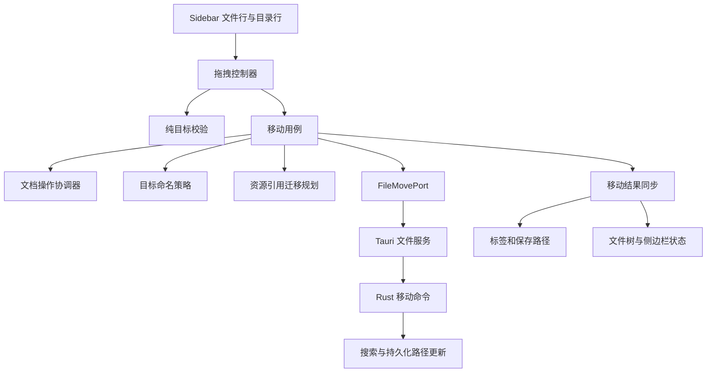

# File Browser 文件拖拽移动方案

状态：首期功能已实现。实际模块、验证方式和支持范围见 [实现与验证说明](file-browser-drag-move-implementation.md)。下文保留历史设计依据和后续跨平台验收清单；与以下最新范围冲突的全工作区扫描、多文档引用更新及移动后递归刷新设计已废止。

目标：将 File Browser 中的单个文件拖到真实目录后完成磁盘移动，自动调整引用使图片和链接继续指向原资源；重名时在扩展名前追加 `01`、`02` 等编号。保持用户编辑内容、未保存状态、撤销历史和预览会话，不增加日常输入或预览的等待时间。

最新要求：为避免移动等待过长，只调整被移动文件自身的图片和链接，保持其指向原资源；取消全工作区引用扫描和其他文档的入站链接自动更新。重名自动编号保留。移动后仅局部更新文件树，不递归刷新根目录。其他文档指向旧路径的链接不会自动修复。

## 1. 当前代码基础

| 位置 | 现状 | 本次接入方式 |
| --- | --- | --- |
| `app/src/components/Sidebar.tsx` | 展示独立文件、Files 虚拟分组、真实目录树，尚无文件拖拽移动 | 增加文件拖拽源和真实目录接收区 |
| `app/src/domain/sidebarTree.ts` | 构建并排序文件树，节点 ID 使用路径 | 增加移动成功后的纯树更新函数，复用未变化节点 |
| `app/src/hooks/useSidebar.ts` | 维护目录树、展开状态、独立文件和高亮；刷新会递归读取整个根目录 | 移动成功后先局部更新，再核对涉及的根目录，过滤过期刷新结果 |
| `app/src/modules/files/service.ts` | 已有 `renameFsEntry(oldPath, newPath)` | 增加独立的 `moveFsEntry` 适配器 |
| `app/src-tauri/src/fs_commands.rs` | `rename_fs_entry` 直接调用 `tokio::fs::rename`，并更新搜索索引队列 | 新增移动命令及不覆盖目标的底层实现 |
| `app/src/hooks/useTabs.ts` | `updateTabsPathByPath` 可修改路径和标题，同时保留内容、dirty 和标签 ID | 复用并补充路径规范化与文档身份检查 |
| `app/src/hooks/useFilePersistence.ts` | 保存维护路径 ref、hash、mtime 及进行中状态 | 增加与移动协调的文档操作边界，及时切换保存路径 |
| `app/src-tauri/src/file_io.rs` | 已有按路径的写入锁 | 将移动纳入共享文件操作协调，不能另建互不关联的锁 |

真实目录移动与虚拟分组调整是不同操作。虚拟分组没有磁盘目录路径，不能传入文件移动命令。

## 2. 首期范围与交互

- 拖拽源：真实目录树中的文件，以及 Files 列表中已有磁盘路径的独立文件。
- 接收区：已展示的真实子目录和根目录行。可以移入同一根目录的另一目录，也可以移入另一个已打开根目录；实际移动必须满足底层文件系统支持条件。
- 首期单文件移动，优先保留文件名，重名时自动编号。目录拖拽、多选批量移动、系统文件管理器拖入、跨磁盘复制后删除作为独立扩展。
- Files 虚拟分组首期不是磁盘移动接收区。后续可独立加入拖拽分组功能，复用已有分组归属服务。
- 左键移动超过约 6 px 才启动拖拽，未达到阈值保持正常单击打开行为；完成拖拽后抑制误触发的 click。
- 拖拽时显示文件名浮层；有效目录高亮，无效目标显示禁止状态。文件行、空白区域和虚拟分组不接受磁盘移动。
- 悬停折叠目录约 600 ms 后展开；靠近列表上下边缘时平滑滚动。离开、取消或完成拖拽后清理计时器和动画帧。
- Esc、窗口失焦、pointercancel 或失去指针捕获时取消。行内重命名和新建输入框不作为拖拽源。
- 同目录放下直接结束，不请求后端，也不生成编号副本。移到其他目录遇到重名时自动选择未占用编号，不覆盖原有文件、不逐次弹重名确认框；成功提示展示实际文件名。
- 正常有效移动不逐次弹确认框；执行期间锁定该文件的重复移动请求。
- 可增加“移动到…”菜单入口，调用同一个用例，为键盘操作提供替代入口。

## 3. 拖拽技术选择

推荐使用 Pointer Events 实现应用内拖拽，封装为 `useFileTreeDragDrop`，暂不新增拖拽库。

状态机为 `idle → armed → dragging → submitting → idle`，任何未提交阶段都可取消。使用 pointer capture 跟踪指针，以 `elementFromPoint` 和目录行标记寻找接收区；浮层设为 `pointer-events: none`，避免遮挡命中检测。一次交互只认定一个目标目录，避免嵌套目录重复处理。

指针位置存入 ref，浮层通过 requestAnimationFrame 更新 transform；只有目标目录变化时才更新局部 React 状态。拖动期间不遍历磁盘、不解析 Markdown，不将坐标提升到 WorkspaceShell。

选择依据：Tauri 的原生拖放处理与 HTML5 拖放存在平台配置差异。官方说明 Windows 使用 HTML5 拖放需要关闭 `dragDropEnabled`。应用内指针拖拽可避免为这一功能调整窗口级原生拖放配置；仍需实际 WebView 验证。

参考：[Tauri WindowConfig](https://v2.tauri.app/reference/config/#windowconfig)。

## 4. 职责与接口



建议新增模块：

```text
app/src/modules/files/
  dragDrop/fileDropPolicy.ts
  application/moveWorkspaceFile.ts
  domain/moveNamePolicy.ts
  ports/fileMovePort.ts
  application/applyFileMoveResult.ts
app/src/modules/markdown/references/
  referenceCollector.ts
  referenceResolver.ts
  relocationPlanner.ts
  sourcePatchApplier.ts
app/src/hooks/
  useFileTreeDragDrop.ts
app/src/modules/document/
  documentOperationCoordinator.ts
app/src-tauri/src/
  file_move.rs
```

接口草案：

```ts
type MoveFileRequest = {
  sourcePath: string
  targetDirectory: string
}

type PreparedFileMove = {
  operationId: string
  oldPath: string
  proposedPath: string
  sourceHash: string
}

type DocumentReferencePatch = {
  path: string
  expectedHash: string
  edits: Array<{ from: number; to: number; insert: string }>
}

type FileMoveOutcome = {
  oldPath: string
  newPath: string
  changed: boolean
  // 附属索引或历史记录同步失败不等于磁盘移动失败。
  reconciliationRequired: boolean
}

interface FileMovePort {
  prepare(request: MoveFileRequest): Promise<Result<PreparedFileMove>>
  commit(operationId: string, patches: DocumentReferencePatch[]): Promise<Result<FileMoveOutcome>>
}

interface DocumentOperationCoordinator {
  runExclusive<T>(documentId: string, operation: () => Promise<T>): Promise<T>
}
```

`Result` 复用项目现有结果类型。`prepare` 的候选路径不是“已移动”结果；`commit` 必须验证源文件哈希、计划有效性和目标占用。如果目标被其他操作抢占，返回可重规划结果，由用例取得新候选名并重算相关引用，不能偷偷改名后沿用旧补丁。磁盘补丁基于已保存正文，编辑器内存补丁单独按文档版本处理。

新增路径操作模块时使用平台路径能力，避免继续散落字符串拼接逻辑。第一期用例明确只接受文件；将来需要目录移动时扩展独立能力和契约，不让当前文件实现伪装支持目录。

| SOLID 原则 | 落地方式 |
| --- | --- |
| 单一职责 | 手势、目标判断、编号、引用解析、迁移规划、文件提交和状态同步分别实现 |
| 开闭原则 | 拖拽和菜单共享移动用例；引用类型通过解析适配器扩展，命名规则通过独立策略替换 |
| 里氏替换原则 | 测试端口和 Tauri 端口遵循相同结果语义；成功表示移动及必要引用改写已完成，重试结果不能伪装成功 |
| 接口隔离 | 拖拽控制器只依赖目标判断和移动回调，不依赖读取文件、保存正文等整个文件服务 |
| 依赖倒置 | 移动用例依赖 FileMovePort 和文档协调接口，由装配层注入具体实现 |

WorkspaceShell 仅装配上述能力，不继续承接指针状态、冲突判断和文件系统细节。

## 5. 后端移动与冲突处理

新增文件移动准备与提交命令，由后端依据源文件名及目录占用情况确定候选目标路径，再配合引用迁移计划提交。前端校验负责交互提示，后端重新验证文件存在、类型、目标目录、合法路径和权限。

### 自动编号规则

| 目标已有内容 | 原文件 | 移动后的名称 |
| --- | --- | --- |
| 无同名文件 | `笔记.md` | `笔记.md` |
| `笔记.md` | `笔记.md` | `笔记01.md` |
| `笔记.md`、`笔记01.md` | `笔记.md` | `笔记02.md` |
| 已有 `笔记01.md` 至 `笔记99.md`，以及原名 | `笔记.md` | `笔记100.md` |
| `README` | `README` | `README01` |

- 编号插入到最后一个扩展名前，保持扩展名原样；最少两位，超过 99 后自然增长。
- 从 `01` 起选择第一个空闲编号，文件或目录占用该名称都算冲突。
- 原始文件名中的数字属于原名，不擅自截断或解释为已有编号；候选名始终根据本次源文件原名生成。
- UI 可预测候选名用于提示，但最终名称由后端实际提交决定。并发占用时继续尝试后续编号，并同步重算依赖该名称的链接。
- 不以无上限循环吞掉其他错误；权限、路径长度、磁盘错误直接返回，取消和重试次数也应有边界。

关键约束：

1. 使用平台路径处理；处理 Windows 盘符、UNC、大小写规则和别名路径，不能统一转小写比较。
2. 首期仅普通文件；符号链接源明确返回不支持，不隐式移动链接指向的文件。目标目录解析实际位置后校验；路径展示与实际身份分开处理。
3. 提取并复用现有路径锁。移动按固定顺序协调源、目标路径，避免与保存同时执行以及多次交叉移动死锁。
4. 提供明确的“不覆盖目标”契约。不能只做 `exists()` 再调用普通 rename：两步之间目标可能被创建。最终提交采用 no-replace/排他创建能力并封装平台差异；目标占用触发重新编号和重新规划，不依赖尚未核实可用的 nightly API。
5. 当前普通 rename 可能覆盖目标，而且不能完成跨挂载点移动，因此不能直接把它作为完整拖拽移动实现。首期跨设备操作返回明确不支持，保留源文件；后续如实现复制后删除，需另行处理校验、元数据保留与部分成功状态。
6. 后端返回最终规范化的 oldPath/newPath；只有移动与必要正文补丁成功后，前端才提交路径及引用变化。对于正文有改写的文件，目标 hash/mtime 也需更新。
7. 搜索索引更新沿用已有异步队列。最近文件、虚拟分组绑定等按路径持久化的数据需要迁移；辅助更新失败返回“移动已完成、需要同步”的状态并支持重试，不能报告整个移动失败并诱发再次移动。

参考：[Rust rename 的覆盖与跨挂载点语义](https://doc.rust-lang.org/std/fs/fn.rename.html)。

## 6. 图片与链接保全

### 6.1 引用规则

先按旧文档位置解析引用目标，再从最终新位置计算指向同一目标的 URL。附件留在原位置，优先生成相对路径；无法表达为相对路径时，由平台资源解析适配器输出应用支持的绝对文件 URL。

例如将 `/资料/草稿/笔记.md` 移到 `/资料/归档/笔记01.md`：

```md
移动前：
移动后：

移动前：[参考](../参考/说明.md#第二节)
移动后：[参考](../参考/说明.md#第二节)
```

上例第二个链接本来就能指向同一资源，保持原文即可。校验依据是“解析后的目标一致”，不是要求所有 URL 都发生字符串变化。

| 引用类型 | 处理 |
| --- | --- |
| Markdown 行内图片、链接 | 按旧基址解析后重算 URL，保留标题和显示文字 |
| 引用式图片、链接 | 修改对应 definition 的 URL，保留引用标识及引用位置 |
| HTML 图片、音视频及链接 | 用 HTML 解析器定位 `src`、`href`、`poster`；`srcset` 按候选资源分别解析 |
| `#标题` 等纯锚点 | 仍指向当前文档，保持原样 |
| `./笔记.md#标题` 等显式自引用 | 将旧文件身份映射到最终 `笔记01.md`，避免指向旧路径或目标目录中的同名文件 |
| HTTP(S)、协议相对 URL、data、mailto 等非本地链接 | 保持原 URL |
| 指向未移动资源的绝对本地路径 | 保持资源目标；按现有解析协议输出 |
| 当前已打开工作区内其他文档指向被移动文件的链接 | 更新到最终新路径及自动编号后的名称，保留 query/hash |
| 代码围栏、行内代码、普通文字 | 不因文本看似路径而改写 |

当前已打开工作区包括真实根目录与已登记的独立文档。入站链接扫描限定在这些已知文档内，不扫描整个磁盘；工作区外未发现的引用不在自动更新范围内。

URL 查询参数和锚点保持原语义；正确区分 `%23` 与 `#`、编码空格与路径分隔符，避免重复编码。资源暂不存在时，保留其原本应解析到的路径，不把“不存在”理解为可以删除链接。

### 6.2 精确修改而非全文重排

复用项目已有的 Markdown 解析栈，解析器定位语义节点，专门的 URL 词法定位器取得原文替换区间。AST 的节点范围不能直接当成 URL 范围。HTML 属性使用对应解析器的来源位置。

按来源位置应用不重叠补丁，只修改 URL，保留中文、转义、标题、缩进、换行风格和 front matter。不能使用全文正则替换，也不能直接重新序列化整篇 Markdown 导致格式变化。相同 definition 只修改一次。

引用解析需与预览、导出实际支持的协议一致。动态 MDX 表达式等无法静态确定的本地引用必须显式列为无法安全迁移的情况，在磁盘提交前处理或阻止该次移动，不能宣称全部引用已保全。

迁移规划属于独立服务，可以放入 Worker 执行。重规划以最终目标路径与内容版本为输入，拖动和日常打字期间不运行全工作区扫描。

### 6.3 磁盘与内存分别处理

- 对磁盘已保存版本生成资源迁移补丁；已打开但未保存的编辑内容单独生成内存补丁，不以移动为由偷偷保存用户全部草稿。
- 原本干净的文档，在磁盘和内存完成同一引用迁移后继续保持干净；原本未保存的修改仍然存在，dirty 依据迁移后的保存基线判断。
- 后台标签同样处理。读到的磁盘版本、操作期间的用户输入、外部文件修改都必须进行版本/hash 校验，失配后重规划。
- 链接改写作为编辑器事务应用并映射光标位置，不能重新创建编辑器。撤销/重做不能恢复依赖旧基址的错误 URL：需要重定位历史适配与专项测试，不能只设置“不记录历史”就认为旧撤销记录安全。

### 6.4 提交与恢复

先生成最终命名及所有必要引用补丁，再校验各文档版本和写入条件，准备临时文件/恢复信息，最后提交移动及补丁。源正文只允许链接迁移的必要修改，字节哈希允许变化，但解析后的资源身份及其内容应保持一致。

多个文件的修改不能假设具有文件系统级原子性。需要操作记录、已完成步骤及补偿流程，提交失败时恢复可恢复的步骤；遇到外部并发变化导致不能安全恢复时保留恢复材料并报告实际状态。不得删除仍用于恢复的源内容，也不得把“文件已移动但必要链接未改写”当成成功。下次启动应能识别并恢复未完成操作。

## 7. 已打开文件与保存一致性

移动已打开文件是本功能的主要一致性边界，不能仅改文件树。

推荐执行顺序：

1. 捕获源文档的稳定 ID、旧路径和操作版本；同一文件去重，取得自动编号后的候选路径。
2. 准备被移动文档及已知工作区内入站链接的补丁。按固定顺序进入受影响文档的操作队列；等待已开始的保存及其完成回调结束，暂停新的磁盘写入提交并校验计划是否仍有效。编辑输入仍可继续，不强制保存未保存正文。
3. 提交后端文件移动和磁盘补丁。目标被抢占时重新编号并规划；其他失败按操作记录恢复，恢复后保留旧路径、用户正文和 dirty，再恢复保存调度。
4. 成功后，在释放队列前统一提交内存引用补丁、所有对应标签的 path/title，以及保存模块的 pathRef、路径状态、hash/mtime 和保存基线。只改匹配的文档，不依据异步结束时“当前活动标签”猜测归属。
5. 保持 tab ID、编辑器实例和用户修改；精确映射光标与编辑历史。提交前后继续输入的内容按版本映射或重算补丁，不能用早先快照覆盖新输入。
6. 恢复自动保存；排队的保存任务执行时读取文档当前路径与快照，不使用入队时捕获的旧路径。对过时保存结果做操作版本检查，防止旧路径回写或旧文件被重新创建。
7. 更新文件树、独立文件记录、选择/高亮、最近文件和路径型缓存。保留既有展开状态，将目标目录展开并定位移动后的文件。

现有保存模块的 `setFilePath` 通过 effect 更新路径 ref，仅依赖它不能作为完整的移动提交边界。需要提供显式路径重定位方法，让 ref 与状态在释放保存队列前一致。

对于后台标签，按文档 ID 保留内存内容即可；对于无磁盘路径的未命名文档，首期不提供文件拖拽移动。

## 8. 文件树和预览性能

- 拖拽过程中只更新浮层和目标行样式，不触发编辑器或预览内容更新。
- 磁盘移动成功后，对源/目标树分支做局部更新；再异步核对受影响的根目录，包含重叠根目录视图。树更新遵循现有目录优先、名称排序规则。
- 文件树刷新带请求序号/树版本，防止较早的异步刷新恢复已移动文件。刷新失败保留已确认的移动结果，并提供重新刷新。
- 预览继续使用稳定文档 ID，不因路径变化重新挂载编辑器。路径基址和改写后的正文必须成对提交；异步预览结果也需要携带匹配的资源基址/重定位版本，不能出现旧正文搭配新基址的中间画面。
- 链接分析仅在放下后按需运行，可在 Worker 计算；大工作区显示移动进行中状态，保持现有预览可读。移动准备耗时与日常输入预览延迟分开测量，不增加预览防抖。

## 9. 验收与交付顺序

### 第一阶段：命名、引用规划与安全提交

- 后端自动编号、不覆盖目标、明确跨设备行为、统一准备/提交结果与恢复记录。
- 编号测试包含原名空闲、连续占用、编号空洞、超过 99、无扩展名、数字原名、同名目录和并发占用重试；已存在的每个文件内容不得改变。
- 引用测试包含行内/引用式链接、图片、HTML 属性、query/hash、中文/空格编码、自引用、工作区入站链接、代码区不改、未存在资源、不同目录深度。
- 使用临时目录验证移动前后引用解析为同一资源；不涉及链接改写的文件字节不变。发生改写的文档只允许预期 URL 补丁。
- 注入文件改动、目标被抢占、写入失败和部分提交失败，验证重规划、恢复流程及重启恢复；不能以成功响应掩盖断链。

### 第二阶段：拖拽交互与界面更新

- 拖拽源、有效目录高亮、悬停展开、边缘滚动、取消和重复提交保护。
- 源/目标树更新、独立文件和标签状态同步；展示最终编号名称，保留目录展开状态。
- 组件测试验证阈值前正常点击、阈值后不误打开、嵌套目录只提交一次、同目录无操作、虚拟分组拒绝磁盘移动、失败后恢复。

### 第三阶段：桌面集成验证

- macOS、Windows、Linux 的实际 Tauri WebView 验证，不能只用浏览器或 jsdom 判断拖拽兼容性。
- 已打开的干净文档、未保存文档、后台标签、自动保存进行中、移动过程中继续输入/切标签、移动后立即保存与撤销/重做；覆盖曾经编辑过链接的历史记录。
- 搜索结果和最近文件可打开新位置；应用重启后树与独立文件路径正确。
- 中文、空格和特殊字符路径；真实目录根行、折叠子目录、重叠根视图；重名自动编号及跨设备失败不丢文件。
- 移动完成和自动编号后，预览、重新打开及导出使用同一原始图片/链接资源；预览不会短暂按错误基址解析。
- 长文档预览和中文输入继续正常；拖拽过程中不增加预览计算、全文转换或整棵目录扫描。
- 执行相关 Vitest、TypeScript、Rust 检查及构建。功能完成后按“新增文件浏览器拖拽移动”计入下一次功能版本。
